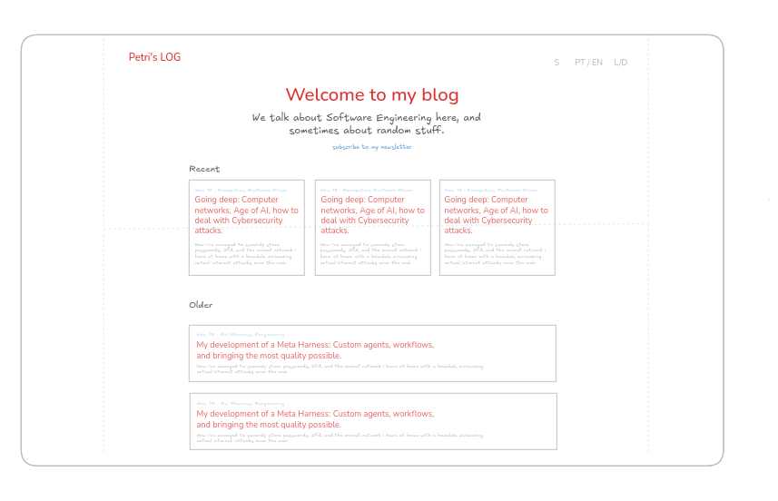
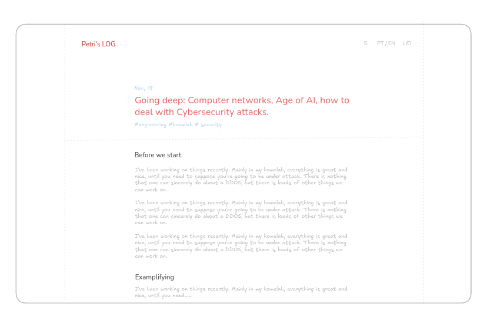

# Design

Where PLOG's look is heading. None of it has been built yet; it becomes CSS in the design system phase.

## Direction

The blog sits somewhere between a blueprint, a technical diagram and an Excalidraw sketch, with a pixelated, dithered texture and an elegant serif for the moments that need impact. Each of these is common on its own, and combining them is the hard part.

## Color

| Role                             | Light mode                                                   | Dark mode      |
| -------------------------------- | ------------------------------------------------------------ | -------------- |
| Background                       | Beige, in the family of the one Fábio Akita uses on his site | Graphite       |
| Impact text (titles, logo)       | Dark red / raspberry                                         | Same red       |
| Accent (metadata, links, guides) | Probably blueprint blue                                      | Same blue      |
| Body text                        | Not chosen yet                                               | Not chosen yet |

Dark mode changes the base colors and keeps the red and blue.

## Typography

Three roles, each loaded through Astro's fonts API in `astro.config.mjs`:

| Role                                | Font               | CSS variable        |
| ----------------------------------- | ------------------ | ------------------- |
| Reading text                        | Google Sans        | `--font-text`       |
| Serif accent for headlines          | Cormorant Garamond | `--font-accent`     |
| Hand-drawn, Excalidraw-like details | Shantell Sans      | `--font-decorative` |

The decorative font is currently applied to every element as a temporary default.

## Wireframes

These are low-fidelity sketches. They show structure, not final colors or fonts.

### Home

- Header: the "Petri's LOG" logo on the left. On the right, a search toggle ("S"), the language switch ("PT / EN") and the light/dark switch ("L/D").
- Dashed vertical guides frame the content column, and a dashed horizontal line crosses the page, like a blueprint grid.
- Hero: a centered "Welcome to my blog" headline in red, a hand-drawn subtitle ("We talk about Software Engineering here, and sometimes about random stuff.") and a small blue newsletter link.
- "Recent": three cards side by side. Each shows date and tags in small blue text, the title in red and a short description in gray.
- "Older": full-width cards with the same anatomy.

### Post

- Same header as the home page.
- Post header: the date in blue, the title in red and the tags in blue, followed by a dashed horizontal rule.
- Body: dark section headings, with body text in gray.

## Open questions

- The wireframe splits the home page into "Recent" and "Older", while the code renders "Highlights" (posts with `highlighted: true`) and "Recents". Decide whether the three cards are the highlights or the latest posts.
- Exact palette values, the body text color, and how the dither and pixel textures are produced (CSS, SVG or images).
